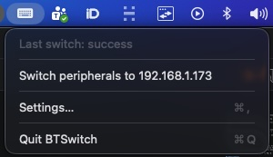
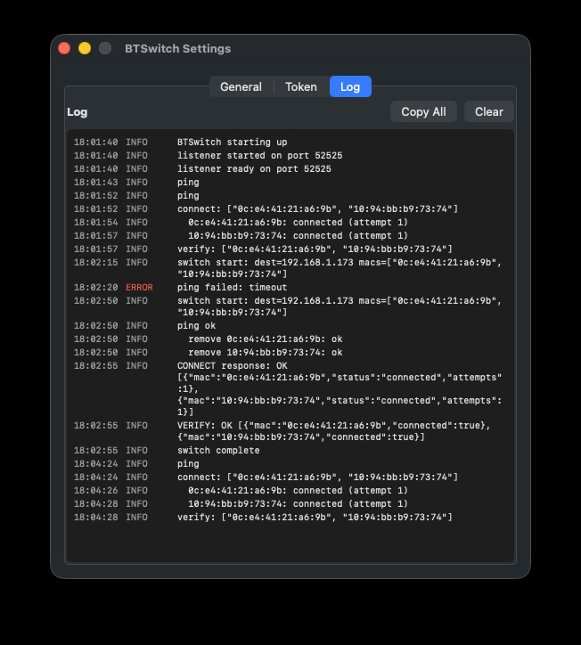

# BTSwitch

A menu bar app that switches your Apple Magic Keyboard, Magic Mouse, and Magic Trackpad between two Macs over your local network.

One click in the menu bar and your peripherals jump to the other Mac. No iCloud account required, no SSH, no kernel extensions, no key remapping.



## Why

If you have two Macs on the same desk — say a personal one and a work one — you've probably tried Universal Control, given up because it doesn't share a single Bluetooth keyboard, tried unpairing/repairing manually, and given up on that too. BTSwitch automates the unpair-on-source / repair-on-destination dance so it happens in a couple of seconds when you click the menu bar icon.

It works with any Bluetooth peripheral that holds only one bond at a time, which includes every Apple Magic peripheral.

### Reliability

BTSwitch uses the same Bluetooth approach as Blue Switch (`IOBluetoothDevicePair.start()` plus the private `remove` selector), with several reliability fixes:

- All IOBluetooth work runs on one dedicated background queue, so pairing callbacks aren't blocked by `openConnection` (without this, pairing hangs after `devicePairingStarted`) and the framework is never used from two threads at once.
- A hard RSSI check fails fast on sleeping peripherals instead of timing out after 10–20 seconds.
- It pings the destination *before* removing peripherals locally, so a network failure can't leave you with no working keyboard.
- A sleeping destination is woken fully before anything moves, and kept awake while it connects (see [The other Mac was asleep](#the-other-mac-was-asleep)).
- If a peripheral doesn't arrive on the destination, BTSwitch reconnects it to the source Mac.
- A peripheral that connected moments ago is given a few seconds to settle before it's unpaired, so a quick switch back doesn't leave the Magic Mouse stuck (see [The mouse stopped responding after switching back quickly](#the-mouse-stopped-responding-after-switching-back-quickly)).
- Only one switch runs at a time. If both Macs are clicked at once, both back off instead of fighting over the peripherals.
- Connection attempts are retried up to 3 times, and `isConnected` is polled briefly afterwards because it can lag.

## How it works

You install BTSwitch on both Macs and pair them once. Each app:

- Announces itself on the local network (Bonjour), so the other Mac can find it by name
- Listens on a local TCP port for switch requests from the paired Mac
- When clicked, removes the configured peripherals from its own Bluetooth database, then asks the paired Mac (over the network) to re-pair and connect them
- Encrypts and signs every request with a key the two Macs agreed during pairing
- Optionally carries your copied text along when you switch

Click the icon on Mac A, peripherals move to Mac B. Click on Mac B, peripherals move back.

## Requirements

- Two Macs on the same local network (Wi-Fi or wired)
- macOS 13 (Ventura) or later
- Xcode Command Line Tools (`xcode-select --install`) to build
- Bluetooth peripherals already paired with both Macs at least once via System Settings

## Install

Clone the repo on each Mac and build:

```bash
git clone https://github.com/sebastianvirlan/BT-Switch.git
cd BT-Switch
./build.sh
```

This produces `build/BTSwitch.app`. Move it into Applications:

```bash
mv build/BTSwitch.app /Applications/
```

The first time you launch it, macOS may show a "developer cannot be verified" warning. Right-click the app and choose **Open** to bypass it.

### Building with Xcode

If you'd rather work in Xcode, install [XcodeGen](https://github.com/yonaskolb/XcodeGen) and generate a project:

```bash
brew install xcodegen
xcodegen generate
open BTSwitch.xcodeproj
```

Build with Cmd+B.

## First-time setup

### 1. Launch and grant permissions (both Macs)

Open BTSwitch from `/Applications` on **both** Macs. macOS will prompt for:

- **Bluetooth permission**: required to switch peripherals
- **Local Network permission**: required so the two Macs can find and talk to each other

Grant both. If you accidentally denied either, enable them under
System Settings → Privacy & Security. If BTSwitch isn't listed there, delete and reinstall the app.

### 2. Pair the two Macs

On either Mac, click the keyboard icon in the menu bar (or right-click it → **Settings…**) and open the **Pairing** tab. The other Mac appears in the list by name; click **Pair**.

The other Mac then shows a prompt like this:

> **"Sebastian's MacBook Pro" wants to pair with BTSwitch**
> **482 913**
> [Allow] [Deny]

Check that the code matches the one shown on the first Mac, then click **Allow** (or press Return). Both Macs now show "Paired". You only do this once.

- **The other Mac isn't listed?** Open "Not listed? Pair by address" and type its IP address (`ipconfig getifaddr en0`). Both Macs must use the same listener port.
- **Codes don't match?** Click **Deny**. Something on the network interfered with the exchange.
- **The other Mac has no keyboard or mouse of its own?** Plug the Magic Keyboard into it with its USB cable; it works over the cable immediately, so you can press Return to approve.

### 3. Choose the peripherals

In the **General** tab, tick the keyboard, mouse and trackpad you want to switch. The list shows the Bluetooth devices paired with this Mac; peripherals you've already chosen stay listed even while they're on the other Mac.

You only need to do this on one Mac: the first time you switch, the other Mac adopts the same list.

### 4. Test

In the **Pairing** tab, click **Test Connection**. You should see "Studio Mac mini is reachable and paired". If you see a red error, it names the cause: BTSwitch not running there, no route, Local Network permission blocked, not paired, and so on. The General tab also shows whether *this* Mac is listening.

## Usage

**Left-click** the menu bar icon to switch peripherals to the other Mac.

**Right-click** for the menu:

- *Switch peripherals to {paired Mac}* — same as left-click
- *Settings…* — open the configuration window
- *Quit*

The icon reflects current state:

| Icon | Meaning |
|---|---|
| Filled keyboard | All peripherals are connected to this Mac |
| Outlined keyboard | Peripherals are on the other Mac |
| Mixed indicator | Some are here, some aren't |
| Spinning arrows | Switch in progress |

## Clipboard

BTSwitch can take your copied text along when you switch, so you can paste it on the other Mac. It's off by default; turn it on in Settings → General → **Clipboard**:

- **Send copied text to … when switching to it**: on the Mac you switch *from*
- **Accept copied text from …**: on the Mac you switch *to*

Each Mac decides for itself, so you can, for example, accept text on one Mac but never send from it. Only plain text up to 256 KB is sent, encrypted with the pairing key. Items that password managers mark as concealed or transient (see [nspasteboard.org](http://nspasteboard.org)) are never sent. The text is sent after the peripherals arrive; if that fails, the switch still counts as successful and the log says why.

## Troubleshooting

### "can't find … on the network"

The paired Mac isn't visible via Bonjour and has no known address yet. Make sure it's awake, on the same network and running BTSwitch. If your network blocks Bonjour, pair by address instead.

### "… refused the connection" / "no route to …"

The other Mac's BTSwitch isn't running, it's asleep, or a firewall blocks TCP on the listener port (default 52525).

### "asleep or out of range"

The peripheral isn't responding to wake signals. Press a key or click the mouse to wake it, then try again.

### "not paired" / "the pairing keys don't match"

The other Mac has forgotten this one (it was unpaired, or paired with a different Mac), or the two have different keys. Open Settings → Pairing and pair them again.

### "pairing was declined" / "nobody approved the pairing"

The other Mac's user clicked **Deny**, or didn't answer within 60 seconds. Start pairing again and click **Allow** on the other Mac.

### "Not listening: port 52525 is already in use"

Another program, usually a second copy of BTSwitch, holds the port. BTSwitch offers to quit another running copy at launch. If something else uses the port, pick a different port on **both** Macs.

### "macOS blocked the connection"

Allow BTSwitch under System Settings → Privacy & Security → Local Network.

### "clocks differ by more than 60s"

Requests are timestamped to prevent replay, so both Macs' clocks must be within 60 seconds of each other. Enable System Settings → General → Date & Time → *Set time and date automatically* on both.

### "the other Mac runs an older/newer BTSwitch"

The network protocol changed (version 3 introduced pairing, version 4 encryption). Update BTSwitch on both Macs.

### Keychain prompt after rebuilding

The pairing key is stored in your Keychain. Because `build.sh` ad-hoc signs the app, each rebuild looks like a new app to the Keychain, and macOS asks whether BTSwitch may read it. Click **Always Allow**.

### Menu bar icon does nothing on click

If this Mac isn't paired yet or has no peripherals configured, left-click opens Settings instead of switching.

### A peripheral connects, then drops

Occasionally a peripheral (most often the Magic Mouse) connects to the destination and drops a moment later. BTSwitch handles this in four steps:

1. Keyboards connect first and the mouse last, and every peripheral gets one attempt before any gets a retry, so a slow mouse never holds up the keyboard. Pairing gets up to 15 seconds once the link is up, because the Magic Mouse can be slow, and a pairing that finishes just after that is kept rather than restarted.
2. A peripheral only counts as arrived once it's both connected *and* paired; a connection without a completed pairing works until the device sleeps, then can't reconnect. The destination re-checks each peripheral shortly after connecting it and retries any that dropped or didn't finish pairing.
3. If one still isn't there, the source asks the destination to try once more.
4. If that fails too, BTSwitch keeps the set together: the destination releases what it got and everything reconnects to the source Mac, so you never end up with the keyboard on one Mac and the mouse on the other. Click the icon to try again.

### The mouse stopped responding after switching back quickly

Unpairing a peripheral tells it to forget the Mac (a "virtual cable unplug"). A Magic Mouse that gets this within about 6 seconds of connecting ignores it, keeps believing it's still paired with that Mac, and then ignores every other Mac until it's switched off and on. Neither Mac can fix that remotely; the destination's macOS log shows `Unplugging virtual cable … failed with status 118` on the Mac that let it go.

So BTSwitch never unpairs a peripheral within 12 seconds of it connecting, whether BTSwitch connected it or it reconnected by itself. Switching straight back after a switch takes a few seconds longer ("letting peripherals settle…") instead of stranding the mouse.

If the mouse is stuck anyway (for example the other Mac runs an older BTSwitch), switch it off and on and click the icon again.

If a peripheral keeps dropping, restart Bluetooth on both Macs:

```bash
sudo pkill bluetoothd    # auto-respawns
```

### The other Mac was asleep

A sleeping Mac can be woken briefly by network traffic (a "dark wake", via Wake for network access or a Bonjour sleep proxy such as an Apple TV or HomePod). It answers on the network with the screen off, then falls asleep again seconds later, often in the middle of pairing. BTSwitch guards against this:

1. The ping wakes the destination fully (as if someone pressed a key, so its screen turns on). BTSwitch removes nothing locally until the destination says it's fully awake, waiting up to 15 seconds. Otherwise you get "… is asleep and didn't wake up fully; nothing was moved".
2. The destination keeps itself from idle-sleeping while it connects the peripherals.
3. While waiting for the destination, the source checks in every few seconds. If the destination stops answering, the source stops waiting and takes the peripherals back right away instead of sitting out the timeout.
4. The source keeps trying to reconnect the peripherals for up to 20 seconds, not just once.
5. If the destination was interrupted by sleep, or ran past its time limit, it releases anything it connected, so it can't take the peripherals after the source has given up.

If it still happens, the destination's log shows "this Mac is going to sleep" during the switch.

### Logs

Settings → **Log** tab shows everything BTSwitch has done. Click **Copy All** to share logs when filing an issue.



## Security

- **Pairing:** the two Macs agree a key with an X25519 key exchange. Both screens show a 6-digit code derived from the exchange, and the receiving Mac's user must click **Allow**. The requesting Mac commits to its key before seeing the other's, so nobody in the middle can make the codes match; an interception shows up as different codes.
- **Requests:** every request and reply is encrypted with ChaCha20-Poly1305 using a key derived from the pairing key, and every request is signed with HMAC-SHA256 and carries a timestamp and a one-time nonce, so requests can't be read, forged or replayed. Each reply is bound to its request. The pairing key never crosses the network.
- **Storage:** the pairing key is stored in the macOS Keychain. The shared token used by earlier versions is deleted on first launch.
- **Unpairing:** clicking **Unpair** on either Mac makes both forget each other. If the other Mac is unreachable at that moment, it keeps its record until it next contacts this Mac and is told it isn't paired.
- **Network exposure:** BTSwitch listens on one TCP port (default 52525) and only accepts connections from local-network addresses: private IPv4 ranges, link-local, IPv6 unique-local, loopback, 100.64.0.0/10 for Tailscale-style VPNs, and any address on the same network segment as one of this Mac's interfaces (for home networks that hand out public IPv6 addresses). It advertises its computer name via Bonjour on the local network.
- No telemetry, no analytics, no network calls outside the LAN.
- The pairing exchange itself is not encrypted: it carries only public keys and the two computer names. Error replies sent before a request is authenticated (such as "not paired") are also plain text and contain nothing secret.
- Removing a peripheral relies on a private IOBluetooth method. If a macOS update removes it, BTSwitch logs a warning instead of silently claiming success.

## Configuration reference

| Setting | Where | Description | Default |
|---|---|---|---|
| Paired Mac | Pairing tab | The other Mac, chosen from the network or by address | (none) |
| Peripherals | General tab | Keyboard, mouse, trackpad to switch, ticked from this Mac's Bluetooth devices | (none; adopted from the other Mac on first switch) |
| Listener Port | General tab | TCP port BTSwitch listens on (must match on both Macs when pairing by address) | 52525 |

Peripherals and port are stored in UserDefaults; the pairing is stored in the Keychain.

## Building from source

The project is a single Swift app, no external dependencies.

```
BTSwitch/
├── BTSwitch/
│   ├── BTSwitchApp.swift          App entry, window management
│   ├── MenuBarController.swift    Menu bar icon and click handling
│   ├── AppSettings.swift          User-configurable settings
│   ├── Keychain.swift             Keychain access
│   ├── PairingStore.swift         The paired Mac and its key
│   ├── PairingController.swift    Pairing, requesting side
│   ├── PairingPrompt.swift        The Allow/Deny prompt, receiving side
│   ├── PeerDirectory.swift        Bonjour discovery
│   ├── ClipboardBridge.swift      Reads/writes the clipboard
│   ├── Protocol.swift             Wire protocol, auth, pairing crypto (pure, unit-tested)
│   ├── SettingsView.swift         Settings UI
│   ├── SwitchCoordinator.swift    Orchestrates a switch
│   ├── BluetoothController.swift  Bluetooth pair/connect/remove
│   ├── NetworkServer.swift        TCP listener and Bonjour advertisement
│   ├── NetworkClient.swift        TCP sender
│   ├── Logger.swift               In-app log buffer
│   ├── AppIcon.icns               App icon (generated by scripts/make-icon.swift)
│   ├── Info.plist
│   └── BTSwitch.entitlements
├── project.yml                    XcodeGen spec
├── scripts/make-icon.swift        Regenerates the app icon
├── Tests/main.swift               Unit tests for Protocol.swift
├── build.sh                       Build script (no Xcode project required)
├── test.sh                        Run unit tests (no Xcode required)
└── README.md
```

`build.sh` invokes `swiftc` directly and ad-hoc signs the resulting bundle. The app uses Apple frameworks only: `IOBluetooth`, `Network`, `AppKit`, `SwiftUI`, `Combine`, `CryptoKit`. The one private API is the `remove` selector described above.

Run the unit tests with:

```bash
./test.sh
```

### Upgrading

- **To 4.x:** traffic between the Macs is now encrypted (protocol `BT-SWITCH/4`). Update **both** Macs; existing pairings keep working.
- **To 3.x:** the shared token is gone; pair the Macs instead (see First-time setup). The protocol is now `BT-SWITCH/3`, so update **both** Macs. Your peripherals and port are kept; the old token and destination address are deleted.
- **From 1.x:** the bundle ID changed from `com.user.btswitch` to `io.github.sebastianvirlan.btswitch`. Peripherals and port are migrated automatically, but macOS treats it as a new app, so you'll be asked for Bluetooth and Local Network permission again.

## Contributing

Issues and pull requests welcome. When reporting a bug, please include:

- macOS version (`sw_vers`)
- Mac model (Apple silicon or Intel)
- A copy of the BTSwitch log (Settings → Log → Copy All)
- Whether the issue happens on both Macs or only one

## License

MIT. See [LICENSE](LICENSE).
